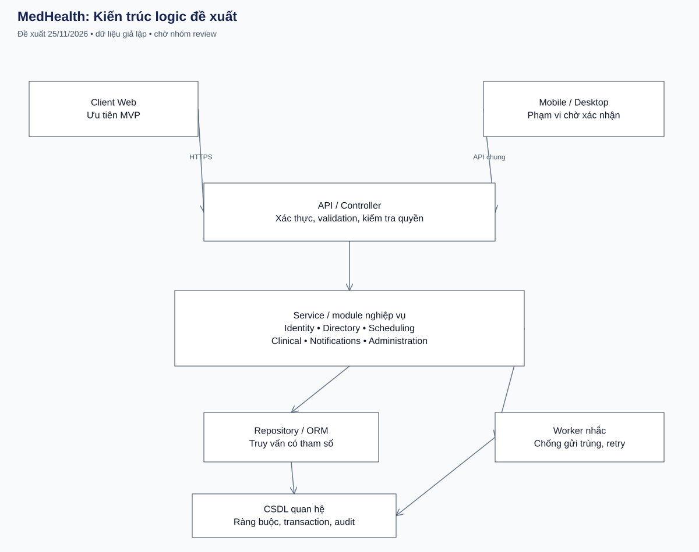
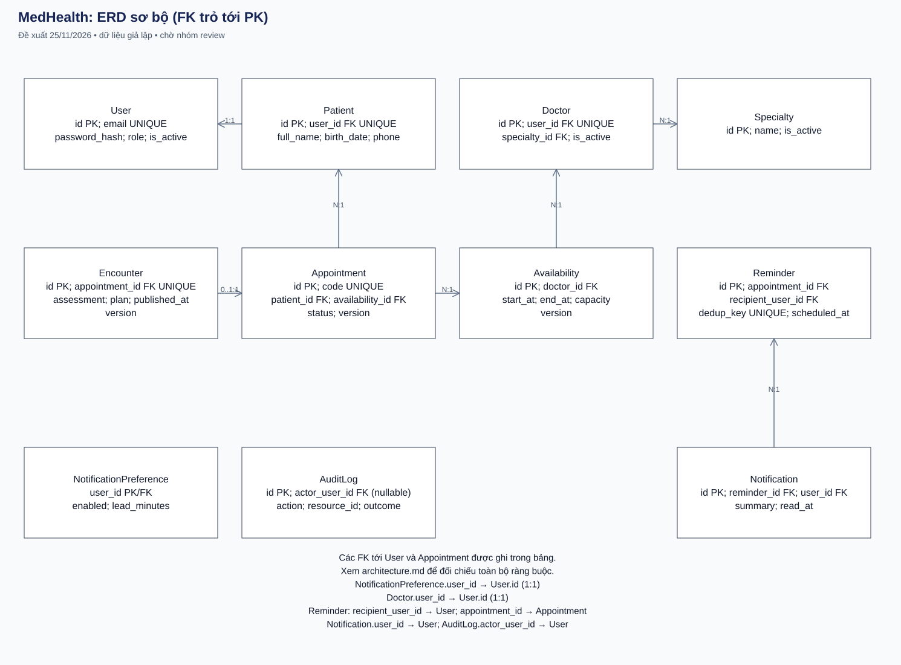

# Kiến trúc và thiết kế dữ liệu MedHealth

Phụ trách: Nguyễn Hữu Huy. Ticket: [SCRUM-16](https://medhealth-app.atlassian.net/browse/SCRUM-16). Trạng thái: đề xuất ngày 25/11/2026, chưa chốt stack và chưa có hệ thống triển khai.

## 1. So sánh phương án

| Phương án | Ưu điểm | Chi phí/giới hạn | Đánh giá cho nhóm |
| --- | --- | --- | --- |
| Một backend chia module và phân lớp, dùng CSDL chung | Dễ chạy local, quản lý giao dịch đặt lịch, ít thành phần vận hành | Cần giữ ranh giới module để tránh mã phụ thuộc lẫn nhau | Đề xuất cho bản học phần |
| Nhiều microservice tách triển khai và dữ liệu | Có thể phát triển/triển khai độc lập khi hệ thống lớn | Thêm xác thực liên dịch vụ, giao dịch phân tán và vận hành | Chưa có nhu cầu đủ rõ để chọn |

Frontend có thể được phục vụ chung hoặc tách ứng dụng tùy stack đã kế thừa. Đề xuất một backend module hóa vẫn cho phép Web/Mobile/Desktop sử dụng API chung; không buộc phải tạo microservice.

## 2. Kiến trúc logic đề xuất

- **Client:** hiển thị dữ liệu, kiểm tra thuận tiện cho người dùng, gọi API và hiển thị lỗi. Không giữ vai trò quyết định quyền/sức chứa.
- **API/controller:** nhận yêu cầu, xác thực, kiểm tra định dạng, chuyển tới service và chuẩn hóa phản hồi.
- **Service:** áp dụng quy tắc nghiệp vụ, điều phối giao dịch, kiểm tra quyền theo chủ tài nguyên.
- **Repository:** truy cập CSDL qua ORM hoặc truy vấn có tham số; không đặt quy tắc nghiệp vụ trong giao diện.
- **CSDL:** khóa, khóa ngoại, unique và giao dịch để bảo toàn dữ liệu.
- **Worker nhắc:** đọc các việc đến hạn, gửi theo kênh được chốt, chống gửi trùng; không tạo thêm một nguồn dữ liệu lịch riêng.

Phiên bản đầu ưu tiên client Web. Mobile/Desktop là client tương lai sau khi API và phạm vi được nhóm xác nhận. Không đặt công nghệ hay hostname triển khai giả trong sơ đồ.

## 3. Module và trách nhiệm

| Module | Trách nhiệm | Không thực hiện |
| --- | --- | --- |
| Identity | Tài khoản, phiên, khóa tài khoản, vai trò | Ghi nội dung khám |
| Directory | Bác sĩ, chuyên khoa, thông tin công khai | Quyết định đặt chỗ |
| Scheduling | Ca/khung giờ, sức chứa, đặt/đổi/hủy lịch | Công bố nội dung bệnh án |
| Clinical | Hồ sơ, lượt khám, nháp/công bố bệnh án | Cho tiếp nhận sửa nội dung chuyên môn |
| Notifications | Tùy chọn nhận, nhắc và trạng thái đã đọc | Tạo lịch hoặc thay trạng thái khám |
| Administration | Thao tác quản trị và số liệu tổng hợp | Bỏ qua kiểm tra quyền tài nguyên |
| Audit | Ghi sự kiện truy cập/thay đổi | Lưu token, mật khẩu hoặc toàn văn bệnh án vào log vận hành |

## 4. Mô hình dữ liệu sơ bộ

| Bảng | Trường chính dự kiến | Ràng buộc và ý nghĩa |
| --- | --- | --- |
| User | id, email, password_hash, role, is_active, created_at | Email đã chuẩn hóa unique; vai trò đơn cho demo là đề xuất cần chốt |
| Patient | id, user_id, full_name, date_of_birth, phone, self_reported_notes | user_id unique FK User; chỉ lưu thông tin cần cho phạm vi |
| Specialty | id, name, is_active | Chuyên khoa phục vụ lọc bác sĩ |
| Doctor | id, user_id, specialty_id, full_name, facility, public_bio, is_active | user_id unique FK User; specialty_id FK Specialty; một chuyên khoa chính trong mô hình ban đầu |
| Availability | id, doctor_id, start_at, end_at, capacity, is_active, version | FK Doctor; end > start; capacity > 0; một dòng là một khung có sức chứa |
| Appointment | id, code, patient_id, availability_id, status, reason, version, created_at | code unique; FK Patient/Availability; bác sĩ được suy ra qua Availability |
| Encounter | id, appointment_id, symptoms, findings, assessment, plan, follow_up_at, published_at, version | appointment_id unique FK Appointment; tránh nhiều bệnh án vô tình cho cùng lịch |
| Reminder | id, appointment_id, recipient_user_id, kind, scheduled_at, status, dedup_key, attempts | FK Appointment/User; dedup_key unique; giới hạn retry được cấu hình |
| Notification | id, reminder_id, user_id, summary, read_at, created_at | FK Reminder/User; summary không chứa toàn văn bệnh án |
| NotificationPreference | user_id, enabled, lead_minutes | user_id PK/FK User; kênh khác bổ sung sau khi được chọn |
| AuditLog | id, actor_user_id, action, resource_type, resource_id, outcome, created_at | Actor có thể null cho request chưa xác thực; không cho người dùng thường sửa/xóa |

`version` hỗ trợ optimistic concurrency. Khóa chính/kiểu dữ liệu cụ thể quyết định khi chọn CSDL. Cần kiểm tra ca trùng bằng giao dịch/khóa hoặc ràng buộc phù hợp với hệ quản trị được chọn; không chỉ kiểm tra ở frontend.

## 5. Các luồng quan trọng

### Đặt lịch

1. Xác thực bệnh nhân và kiểm tra request/idempotency key.
2. Mở transaction, khóa dữ liệu khung giờ hoặc dùng cơ chế tương đương của CSDL.
3. Kiểm tra thời gian, hoạt động, sức chứa và số lịch đang chiếm chỗ theo quy tắc trạng thái trong requirements.
4. Tạo đúng một Appointment; commit; sau đó tạo/lập nhắc theo cơ chế nhất quán đã chọn.
5. Retry cùng key phải trả cùng kết quả. Cách lưu key/payload/kết quả và thời gian giữ key cần được thiết kế trong SCRUM-23, trước triển khai.

### Đổi/hủy

Đổi phải kiểm tra lịch gốc, hạn xử lý, phiên bản và khung mới trong transaction; thất bại rollback để giữ lịch gốc. Khi khóa nhiều khung, dùng thứ tự khóa ổn định để giảm deadlock. Hủy là chuyển trạng thái, không xóa lịch. Nhắc cũ bị cập nhật/vô hiệu sau thay đổi.

### Bệnh án và truy cập

Server kiểm tra bác sĩ được giao qua Appointment → Availability → Doctor. Bệnh nhân chỉ đọc Encounter đã có published_at của mình. Nhân viên tiếp nhận chỉ thao tác lịch, không sửa Clinical. Mọi thay đổi dùng version để phát hiện ghi đè từ dữ liệu cũ.

## 6. Các quyết định vận hành còn mở

- Giữ session phía server hay token, cách thu hồi phiên khi khóa tài khoản.
- CSDL/ORM, phương án chống ca trùng và đặt vượt sức chứa.
- Retry/idempotency, scheduler/queue và xử lý lỗi sau commit.
- Thời hạn lưu audit/backup và phân quyền môi trường demo.
- Quy trình migration/rollback, biến môi trường và nơi chạy demo.

Chưa có số đo hiệu năng hoặc chứng nhận bảo mật. Nhóm cần kiểm thử theo requirements và test case trước khi ghi nhận kết quả. Tham khảo [ADR](decisions/0001-architecture.md) và [kế hoạch API](api-plan.md).
