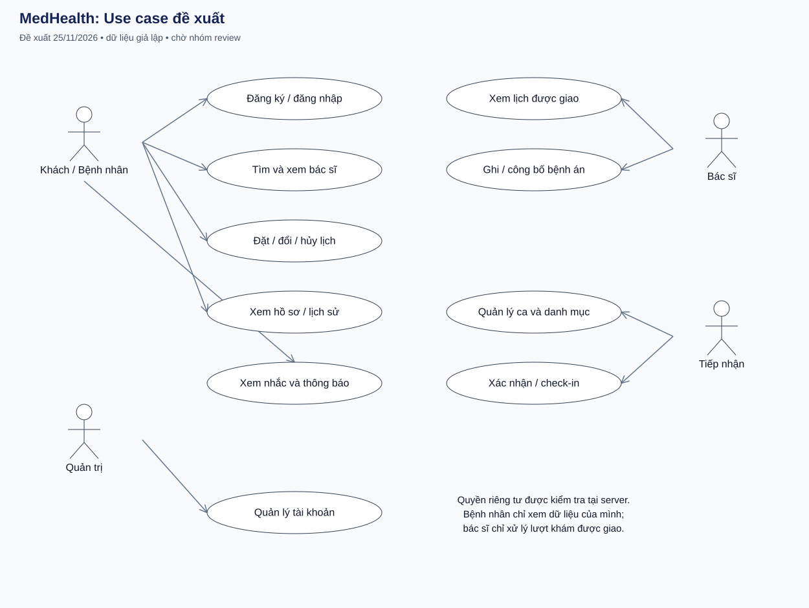

# Yêu cầu hệ thống MedHealth

Phụ trách: Thái Trương. Ticket: [SCRUM-15](https://medhealth-app.atlassian.net/browse/SCRUM-15). Bản nháp ngày 25/11/2026, chờ nhóm review.

## 1. Bài toán và mục tiêu

MedHealth hỗ trợ người bệnh tìm bác sĩ, đặt lịch và theo dõi kết quả khám; hỗ trợ cơ sở tổ chức lịch, tiếp nhận và lưu thông tin khám trên một hệ thống thống nhất. Bản học phần ưu tiên một luồng Website hoàn chỉnh. Mobile/Desktop và kênh gửi nhắc bên ngoài cần được xác nhận trong buổi review phạm vi.

Nguồn yêu cầu: mô tả MedHealth người dùng đã cung cấp, Product Backlog Jira và yêu cầu học phần về Sprint 0. Các quy tắc chi tiết dưới đây là đề xuất cần nhóm xác nhận; chưa có biên bản khảo sát cơ sở y tế thực tế.

## 2. Tác nhân

| Tác nhân | Nhu cầu | Giới hạn đề xuất |
| --- | --- | --- |
| Khách | Tìm và xem thông tin bác sĩ công khai | Không xem thông tin riêng của bệnh nhân |
| Bệnh nhân | Quản lý tài khoản, lịch hẹn, hồ sơ của mình | Không truy cập dữ liệu của bệnh nhân khác |
| Bác sĩ | Xem lịch được giao, ghi nội dung lần khám | Không sửa bệnh án của bác sĩ khác nếu chưa được phân quyền |
| Nhân viên tiếp nhận | Quản lý lịch và check-in | Không sửa nội dung bệnh án chuyên môn |
| Quản trị | Quản lý tài khoản và danh mục | Không mặc định có quyền chỉnh sửa nội dung chuyên môn |

## 3. Danh sách US và tiêu chí nghiệm thu đề xuất

Các mã US dưới đây là mã truy vết trong tài liệu, không thay thế mã Jira. Điểm và Assignee đọc từ Jira để tránh tạo thêm một bản phân công dễ sai lệch. Thứ tự ưu tiên trong tài liệu backlog review cần cả nhóm chốt.

| Mã | User Story | Jira | Tiêu chí nghiệm thu chính |
| --- | --- | --- | --- |
| US-01 | Là bệnh nhân, tôi muốn đăng ký tài khoản để sử dụng dịch vụ đặt khám. | SCRUM-1 | Dữ liệu hợp lệ tạo một tài khoản; email trùng không tạo thêm; trường thiếu/sai có lỗi rõ; phản hồi không chứa hash mật khẩu. |
| US-02 | Là người dùng, tôi muốn đăng nhập và đăng xuất để truy cập đúng tài khoản. | SCRUM-5 | Thông tin đúng tạo phiên; sai thông tin không tiết lộ tài khoản tồn tại; đăng xuất/hết phiên chặn truy cập tài nguyên riêng. |
| US-03 | Là bệnh nhân, tôi muốn tìm bác sĩ theo tên/chuyên khoa để chọn người khám phù hợp. | SCRUM-6 | Tìm tên có/không dấu theo quy tắc đã chọn; lọc kết hợp và phân trang ổn định; rỗng/lỗi tải có trạng thái riêng. |
| US-04 | Là bệnh nhân, tôi muốn xem hồ sơ bác sĩ để biết chuyên khoa và nơi khám. | SCRUM-7 | Mở đúng hồ sơ theo ID; chỉ hiển thị dữ liệu được công bố; bác sĩ không khả dụng có thông báo phù hợp. |
| US-05 | Là nhân viên, tôi muốn cấu hình ca khám để cung cấp khung giờ nhận bệnh nhân. | SCRUM-20 | Không nhận giờ kết thúc trước bắt đầu; phát hiện ca trùng của một bác sĩ; thay đổi ca đã có lịch phải báo ảnh hưởng. |
| US-06 | Là bệnh nhân, tôi muốn xem khung giờ còn chỗ để chọn lịch. | SCRUM-21 | Không chọn giờ quá khứ/đã đầy; tải lại phản ánh số chỗ mới; ngày không có lịch có thông báo. |
| US-07 | Là bệnh nhân, tôi muốn đặt một khung khám để có lịch hẹn được ghi nhận. | SCRUM-23 | Tạo lịch và mã tra cứu; hai yêu cầu vào chỗ cuối không vượt sức chứa; gửi lại cùng yêu cầu không tạo trùng. |
| US-08 | Là bệnh nhân, tôi muốn xem các lịch hẹn của mình để theo dõi trạng thái. | SCRUM-24 | Chỉ trả lịch của tài khoản hiện tại; lọc được thời gian/trạng thái; chi tiết và danh sách nhất quán. |
| US-09 | Là bệnh nhân, tôi muốn đổi/hủy lịch khi kế hoạch thay đổi. | SCRUM-25 | Chỉ thực hiện trong điều kiện được chốt; hủy trả đúng số chỗ; đổi thất bại không làm mất lịch gốc. |
| US-10 | Là nhân viên tiếp nhận, tôi muốn xác nhận và check-in để tổ chức khám. | SCRUM-26 | Chỉ vai trò được phép thao tác; lịch hủy không check-in; thay đổi có người thực hiện và thời điểm. |
| US-11 | Là bác sĩ, tôi muốn xem lịch được phân công để bắt đầu và hoàn tất lượt khám. | SCRUM-27 | Không xử lý lịch ngoài quyền; trạng thái chuyển đúng thứ tự; các client thấy cùng trạng thái sau tải lại. |
| US-12 | Là bệnh nhân, tôi muốn cập nhật hồ sơ cá nhân để thông tin khám chính xác. | SCRUM-29 | Lưu/tải lại thông tin hợp lệ; từ chối ngày sinh tương lai; tách thông tin tự khai khỏi nội dung bác sĩ ghi. |
| US-13 | Là bác sĩ, tôi muốn ghi bệnh án gắn với lịch hẹn để lưu kết quả khám. | SCRUM-30 | Gắn đúng lịch/bệnh nhân/bác sĩ; chỉ người có quyền sửa; phát hiện cập nhật từ phiên bản dữ liệu cũ. |
| US-14 | Là bệnh nhân, tôi muốn tra cứu lịch sử khám để theo dõi sức khỏe. | SCRUM-31 | Chỉ xem dữ liệu của mình; bản nháp chưa công bố không hiển thị; mở đúng lần khám. |
| US-15 | Là bệnh nhân, tôi muốn chọn nhận nhắc và xem thông báo để không bỏ lỡ lịch. | SCRUM-35, SCRUM-37 | Lưu tùy chọn; thông báo thuộc đúng người; đánh dấu đã đọc cho số đếm nhất quán. |
| US-16 | Là quản trị, tôi muốn khóa/mở tài khoản để kiểm soát quyền sử dụng. | SCRUM-38 | Chỉ quản trị thao tác; tài khoản khóa không dùng phiên cũ; chặn làm mất quản trị viên hoạt động cuối cùng. |
| US-17 | Là người quản lý, tôi muốn xem số lượng lịch theo thời gian để theo dõi hoạt động. | SCRUM-39 | Cách đếm rõ; tổng đối chiếu dữ liệu demo; không đưa nội dung bệnh án vào báo cáo tổng hợp. |

Phân quyền (SCRUM-18), danh mục (SCRUM-19), worker nhắc (SCRUM-36), audit và backup là công việc kỹ thuật hỗ trợ các US, được kiểm thử cùng luồng nghiệp vụ.

## 4. Sáu use case chi tiết

### UC-01. Đăng ký tài khoản

- Tác nhân: khách muốn tạo tài khoản bệnh nhân.
- Tiền điều kiện: hệ thống khả dụng; chưa có tài khoản cùng email.
- Luồng chính: mở Đăng ký → nhập tên, email, mật khẩu và xác nhận → gửi → hệ thống kiểm tra → tạo tài khoản/hồ sơ bệnh nhân → hướng dẫn đăng nhập.
- Ngoại lệ: thiếu trường, email sai/trùng, mật khẩu không khớp, gửi lặp, mất mạng. Không tạo tài khoản dở dang.
- Hậu điều kiện: đúng một tài khoản có vai trò bệnh nhân; mật khẩu không lưu dạng đọc được.
- Cần chốt: chính sách mật khẩu và xác minh email có nằm trong MVP không.

### UC-02. Đăng nhập và đăng xuất

- Tác nhân: người dùng đã có tài khoản hoạt động.
- Tiền điều kiện: tài khoản tồn tại và không bị khóa.
- Luồng chính: mở Đăng nhập → nhập thông tin → kiểm tra → tạo phiên → mở trang theo vai trò; chọn Đăng xuất để kết thúc phiên.
- Ngoại lệ: sai thông tin, quá nhiều lần thử, tài khoản khóa, phiên hết hạn. Thông báo lỗi đăng nhập không phân biệt email có tồn tại.
- Hậu điều kiện: phiên chỉ truy cập được chức năng trong quyền; đăng xuất vô hiệu phiên theo cơ chế được chọn.
- Cần chốt: thời lượng phiên, ngưỡng giới hạn thử sai, cơ chế khôi phục mật khẩu.

### UC-03. Tìm và xem bác sĩ

- Tác nhân: khách hoặc bệnh nhân.
- Tiền điều kiện: có danh mục bác sĩ đã công bố.
- Luồng chính: mở danh sách → nhập tên/chọn chuyên khoa → xem kết quả → mở hồ sơ → chọn xem lịch trống.
- Ngoại lệ: không có kết quả, bác sĩ ngừng hoạt động, lỗi mạng hoặc trang không tồn tại.
- Hậu điều kiện: hiển thị đúng thông tin công khai, không tạo lịch hẹn ở bước tìm kiếm.

### UC-04. Đặt lịch khám

- Tác nhân: bệnh nhân.
- Tiền điều kiện: đã đăng nhập; bác sĩ/khung giờ còn hiệu lực và còn chỗ.
- Luồng chính: chọn bác sĩ → chọn ngày/giờ → nhập lý do khám → kiểm tra thông tin → xác nhận → server kiểm tra và giữ chỗ trong giao dịch → trả mã lịch.
- Ngoại lệ: chỗ vừa hết, giờ đã qua, dữ liệu sai, phiên hết hạn, nhấn xác nhận nhiều lần. Không vượt sức chứa, không tạo lịch trùng do retry.
- Hậu điều kiện: có lịch gắn đúng bệnh nhân và khung giờ; số chỗ còn lại được cập nhật.
- Cần chốt: có cho phép một bệnh nhân đặt các lịch giao nhau không; xác nhận tự động hay qua tiếp nhận.

### UC-05. Đổi hoặc hủy lịch

- Tác nhân: bệnh nhân sở hữu lịch.
- Tiền điều kiện: lịch ở trạng thái và thời điểm còn được đổi/hủy theo chính sách nhóm chốt.
- Luồng chính: mở lịch → chọn Đổi/Hủy → nhập lý do nếu được yêu cầu → với Đổi, chọn khung mới → xác nhận → server xử lý nguyên tử → hiển thị kết quả.
- Ngoại lệ: ngoài hạn, sai chủ sở hữu, lịch đã khám/hủy, chỗ mới hết. Nếu đổi không thành công thì giữ nguyên lịch gốc.
- Hậu điều kiện: trạng thái/sức chứa đúng; nhắc cũ được cập nhật hoặc vô hiệu.
- Cần chốt: hạn đổi/hủy, số lần đổi và cách xử lý ca bị nhân viên điều chỉnh.

### UC-06. Xem lịch sử khám

- Tác nhân: bệnh nhân.
- Tiền điều kiện: đã đăng nhập; có thể chưa có lần khám nào.
- Luồng chính: mở Lịch sử khám → lọc khoảng ngày → chọn lần khám → xem nội dung đã công bố.
- Ngoại lệ: chưa có dữ liệu, bản nháp, dữ liệu không thuộc quyền, mất mạng.
- Hậu điều kiện: không thay đổi nội dung bệnh án; không công khai dữ liệu người khác.
- Cần chốt: các trường bệnh án được công bố, quy trình chỉnh sửa sau công bố.

## 5. Yêu cầu phi chức năng đề xuất

| Mã | Yêu cầu | Cách kiểm tra dự kiến |
| --- | --- | --- |
| NFR-01 | Kiểm tra đăng nhập, vai trò và quyền trên tài nguyên tại server | Thử đổi ID tài nguyên, gọi API bằng tài khoản khác vai trò |
| NFR-02 | Không lưu mật khẩu dạng đọc được, không ghi secret/toàn văn bệnh án vào log vận hành | Review cấu hình, mã xử lý và log demo |
| NFR-03 | Đặt lịch đồng thời không vượt số chỗ, thao tác retry không tạo trùng | Chạy hai yêu cầu vào chỗ cuối, gửi lại cùng mã yêu cầu |
| NFR-04 | Có tải, rỗng, lỗi, nhãn trường và điều hướng bàn phím cho luồng chính | Kiểm thử giao diện và bàn phím |
| NFR-05 | Có hướng dẫn cài đặt, backup/restore dữ liệu demo và truy vết phiên bản | Thử từ clone sạch và diễn tập phục hồi |
| NFR-06 | Thời gian phản hồi và số người dùng đồng thời được nhóm chốt trước đo | Ghi môi trường, dataset, tải và p95 thực đo; chưa đặt con số tùy ý |

## 6. Quy tắc dữ liệu và trạng thái cần review

- Thời gian lưu ở UTC, hiển thị theo múi giờ Asia/Bangkok trong bản demo.
- Ca đã có lịch không bị xóa làm mất lịch; ưu tiên ngừng nhận lịch mới và xử lý ảnh hưởng.
- Bệnh nhân chỉ tự sửa dữ liệu cá nhân/tự khai; bác sĩ được giao mới sửa ghi nhận chuyên môn theo quyền.
- Chuỗi trạng thái lịch đề xuất: Pending → Confirmed → CheckedIn → InProgress → Completed. Pending/Confirmed có thể sang Cancelled theo điều kiện; Pending có thể sang Rejected kèm lý do.
- `Pending`, `Confirmed`, `CheckedIn`, `InProgress` chiếm chỗ; `Cancelled`, `Rejected` không chiếm chỗ. Khung quá khứ không nhận lịch mới dù lịch đã Completed. Đây là quy ước đề xuất, cần dùng nhất quán ở API, DB và test.
- Không coi `NoShow` là bắt buộc trong MVP khi nhóm chưa chốt quy trình.

## 7. Câu hỏi nhóm cần chốt

1. Mã nguồn 2024–2025 hiện ở đâu, sử dụng được phần nào?
2. Web/Mobile/Desktop có bắt buộc cùng hoàn thành trong học phần không?
3. Chính sách mật khẩu, xác minh email và thời hạn phiên là gì?
4. Khi nào lịch được xác nhận; hạn đổi/hủy tính như thế nào?
5. Trường thông tin bệnh án nào được công bố và ai được sửa sau công bố?
6. Có cần email/push hoặc chỉ thông báo trong ứng dụng?
7. Deadline học phần, thời gian tham gia mỗi thành viên và mục tiêu tải kiểm thử là gì?

## 8. Sơ đồ và review

[Mở bản chỉnh sửa diagrams.net](diagrams/use-case.drawio). Người review dự kiến: Đăng và Huy. Kết quả hiện tại: chờ review, chưa có biên bản xác nhận.
