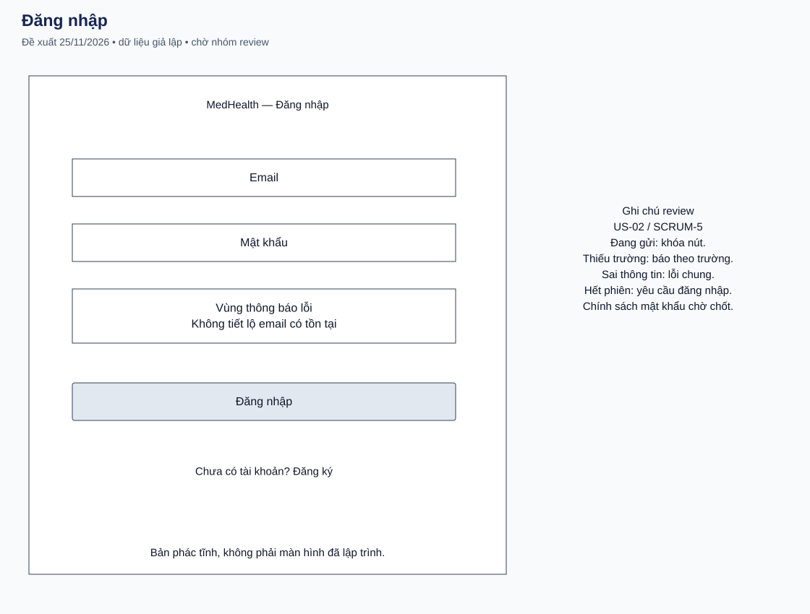
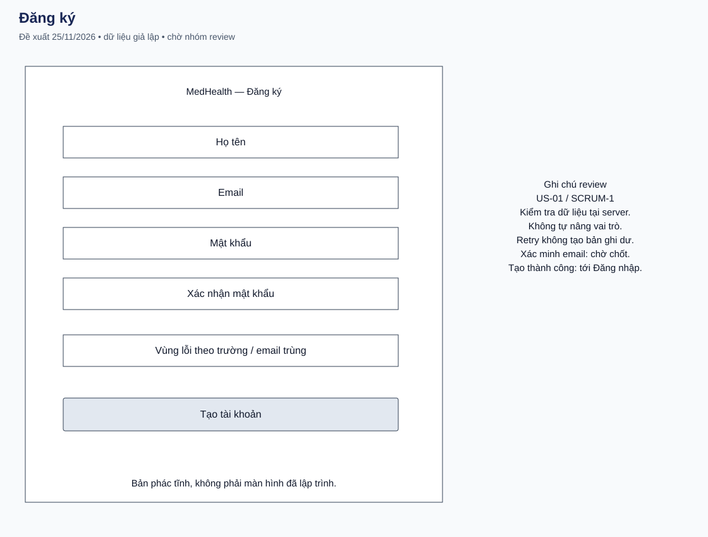
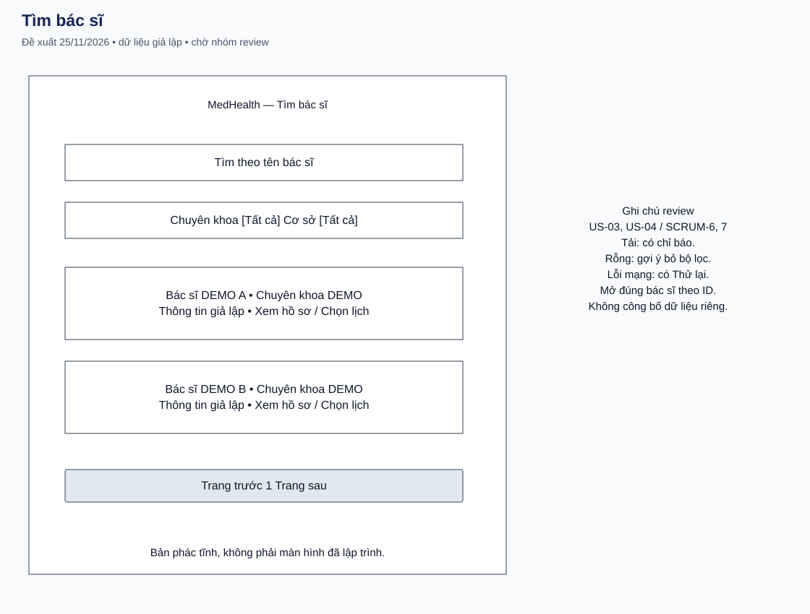
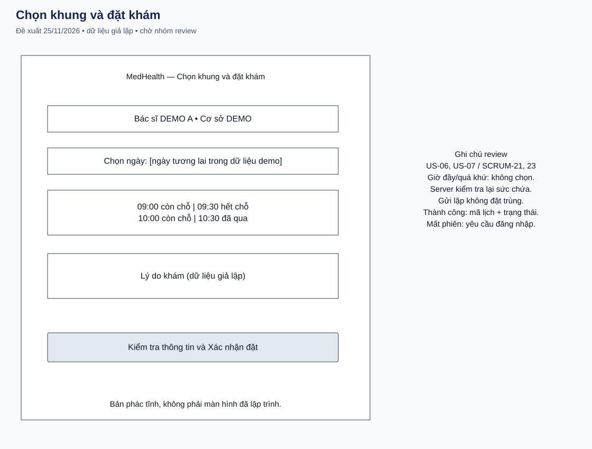
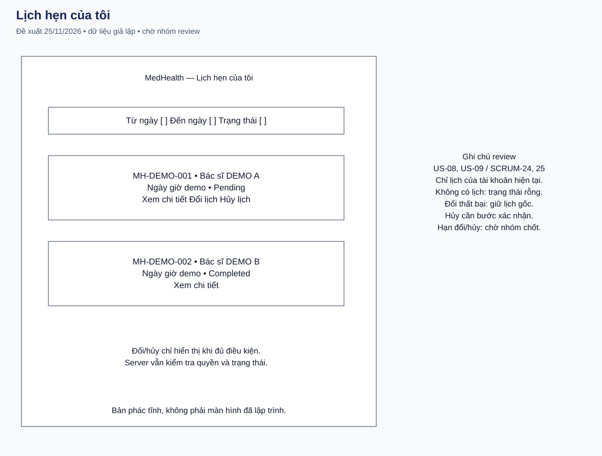

# Phác thảo giao diện MedHealth

Phụ trách: Diễm Hương Hoàng Thị. Ticket: [SCRUM-54](https://medhealth-app.atlassian.net/browse/SCRUM-54).

Đây là 5 bản phác tĩnh để nhóm thảo luận, chưa phải giao diện được lập trình. Tên bác sĩ, cơ sở và mã lịch có chữ DEMO là dữ liệu giả lập. Các nút/ô nhập trong ảnh chỉ minh họa vị trí và ý định thao tác.

## Luồng đề xuất

Khách mở Đăng ký → hoàn tất → Đăng nhập → Tìm bác sĩ → xem hồ sơ/chọn khung → xác nhận đặt → xem Lịch hẹn của tôi. Đổi/hủy đi từ chi tiết lịch, chỉ được phép khi đủ điều kiện do nhóm chốt. Màn hình hồ sơ bác sĩ chi tiết sẽ bổ sung khi refine US-04; không coi một thẻ kết quả là màn hình hồ sơ hoàn chỉnh.

## Các màn hình

### 1. Đăng nhập

US-02 / SCRUM-5. Thông báo sai thông tin chung, không tiết lộ email tồn tại; xử lý gửi, lỗi và hết phiên.

### 2. Đăng ký

US-01 / SCRUM-1. Họ tên, email, mật khẩu và xác nhận mật khẩu; quy tắc mật khẩu/xác minh email chờ nhóm chốt.

### 3. Tìm bác sĩ

US-03 / SCRUM-6. Tìm tên, lọc chuyên khoa/cơ sở, kết quả, phân trang; xử lý tải, rỗng và lỗi mạng.

### 4. Chọn khung và đặt lịch

US-06, US-07 / SCRUM-21, SCRUM-23. Giờ đầy/quá khứ không chọn được; server kiểm tra lại sức chứa khi xác nhận.

### 5. Lịch hẹn của tôi

US-08, US-09 / SCRUM-24, SCRUM-25. Xem lịch riêng, mở chi tiết, đổi/hủy khi hợp lệ; đổi thất bại giữ lịch gốc.

## Chỉnh sửa và review

Mở [wireframes.drawio](wireframes.drawio) bằng diagrams.net, dùng các trang tương ứng để chỉnh sửa. Xuất lại SVG của trang đã sửa. Thái kiểm tra đúng nghiệp vụ, Đăng review phạm vi. Khi sửa trường/thao tác hoặc trạng thái, cập nhật [test case](../test-cases.md) và bảng Excel tương ứng.

Các trạng thái lỗi và rỗng được ghi bằng chú thích cạnh bản phác. Đây chưa phải bộ thiết kế đầy đủ cho tất cả kích thước màn hình; bố cục responsive và tương tác bàn phím cần kiểm tra khi có frontend.
